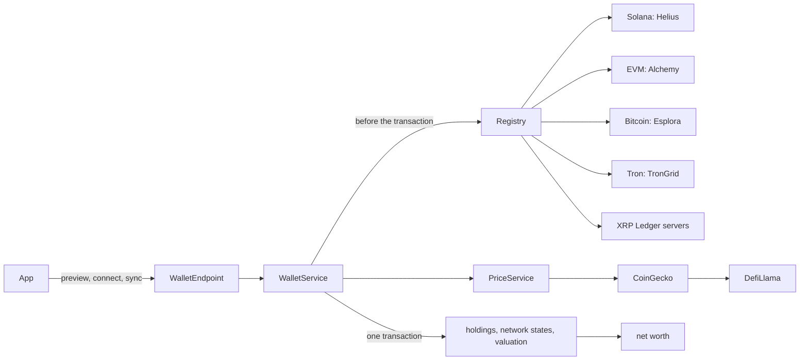

# Multi-chain wallets

Status: design, 13 November 2026.
Audience: the owner, and the implementation agents working through the build plan in [section 10](#10-build-plan).
Companions: [`data-model.md`](data-model.md) (the entity schema this extends), [`tax-jurisdictions.md`](tax-jurisdictions.md) (crypto tax: section 4.8 and tasks C6 to C9) and [`money-guide.md`](money-guide.md).

The owner asked to "add support for all major blockchains even outside of Solana so that assets can be viewed from anywhere." Today a wallet is a Solana address, read through Helius, valued in US dollars and carried into net worth by a `crypto` account. This document extends that to every major chain. It covers which chains count, where their data comes from, how addresses are checked, how assets are priced and filtered, the one schema migration, how syncs run and what they cost, the app, and the order of the work.

Viewing is read-only. OpenBudget never holds a private key, never asks for one, and never signs anything.

Contents:

1. [Decisions at a glance](#1-decisions-at-a-glance)
2. [What exists today](#2-what-exists-today)
3. [Chains](#3-chains)
4. [Data sources](#4-data-sources)
5. [Address input and validation](#5-address-input-and-validation)
6. [Prices, spam and staleness](#6-prices-spam-and-staleness)
7. [Schema](#7-schema)
8. [Sync](#8-sync)
9. [App](#9-app)
10. [Build plan](#10-build-plan)
11. [Owner decisions](#11-owner-decisions)
12. [Risks](#12-risks)
13. [Sources](#13-sources)

## 1. Decisions at a glance

1. **Read-only, from the server, never keys.** The server reads public chain data for an address. The shared address parser refuses private keys, recovery phrases and extended private keys on the device, before anything is sent ([section 5.3](#53-inputs-we-refuse)).
2. **Launch set:** Solana (as today), Bitcoin (addresses and `xpub`, `ypub` and `zpub` keys), seven EVM chains from one address (Ethereum, Base, Arbitrum One, OP Mainnet, Polygon PoS, BNB Smart Chain and Avalanche C-Chain), Tron and the XRP Ledger. **Later set**, in order: Hyperliquid, Dogecoin and Litecoin, Cardano, TON, Sui and Aptos.
3. **One wallet is one address, or one HD key, in one chain family, and it values one crypto account.** An EVM wallet reads several networks. Every holding records its network, so holdings group by chain.
4. **Data sources:** Alchemy for the EVM chains. Free per-chain infrastructure everywhere else: Esplora (mempool.space, with Blockstream as fallback) for Bitcoin, TronGrid for Tron and the public XRP Ledger servers. Helius stays for Solana. Every source sits behind the existing `WalletProvider` seam.
5. **Prices:** CoinGecko on a paid plan (Basic, $35 a month, which carries the commercial licence) prices every chain except Solana. DefiLlama is the keyless fallback. Solana keeps Helius, Jupiter and Magic Eden. Price services receive asset ids, never wallet addresses.
6. **A holding counts toward net worth only when it is priced and not suspected spam.** The classifier runs on every chain, including Solana. The user can hide or allow any holding, and that choice survives syncs.
7. **A cached price counts for 7 days.** After that, the holding is unpriced until a source quotes it again. The app shows how old each network's amounts are, from its last successful read, and marks old prices.
8. **One migration.** `WalletNetwork` moves to `openbudget_core` with 17 new values. `wallet` gains `scanNetworks` and a sealed HD descriptor. Holdings and transactions gain a backfilled `network`. Holdings also gain a `position` (available, staked or unclaimed rewards) and a `spamVerdict`. A new `wallet_network_state` table records each network's last read and history cursor. Existing Solana rows keep working.
9. **Reads and revaluations are separate.** A chain read (quantities) happens on connect, on pull-to-refresh, and on a plan cadence: every 24 hours on the free plan and every 6 hours on Plus. A revaluation (prices only, no chain calls) runs for every wallet every hour.
10. **New chains launch holdings-only.** Transaction history follows chain by chain (EVM, Bitcoin, Tron, then the XRP Ledger), feeding the tax lot engine in [`tax-jurisdictions.md`](tax-jurisdictions.md#48-digital-assets-and-capital-gains) (tasks C7 and C9). Solana keeps its history.
11. **Names such as ENS and SNS are out at launch.** ENS comes first if users ask.
12. **The app has one paste field that detects the chain.** Each chain is a perforated stamp in a Riso spot ink. Holdings group by chain, and net worth breaks down by chain and by asset.

## 2. What exists today

- `WalletProvider.fetchSnapshot(network, address, untilSignature)` returns holdings with price candidates, parsed transactions and warnings. It does every network call before `WalletService` opens its transaction, so a slow provider never holds a row lock. `SolanaWalletProvider` implements it with Helius (balances, DAS assets, history), Jupiter (token prices) and Magic Eden (NFT floors).
- `WalletService.sync` commits holdings, transactions, the `lastSignature` cursor, a FIFO P&L estimate and today's `account_valuation` (source `wallet`, in USD) in one transaction, or nothing. A failed sync marks the wallet `failed` and leaves the last committed facts alone.
- `wallet` is unique on `(entityId, network, address)`, and `wallet_holding` is unique on `(walletId, assetId)`. `asset_price` caches prices on `(network, assetId)` for 15 minutes.
- `WalletService._requireAddress` accepts only Solana addresses, and `_requireNetwork` only the two Solana networks. The app's add-account screen has one "Connect wallet" button with the Solana icon. It always sends `solanaMainnet`.
- Quantities are `BigInt quantityRaw` with per-asset `decimals` (0 to 36). Values are `*Minor` integers in `priceCurrencyCode`. Wallet accounts are in USD ([`data-model.md`](data-model.md) Q8), and net worth converts them like any foreign account.

What has to change for more chains: address parsing, the network list, a holding's network, per-network read state, an HD key store, a price source that is not Solana-specific, spam rules, and a sync that can partly succeed.

## 3. Chains

### 3.1 Launch set

Market ranks are from CoinGecko-based rankings on 1 and 13 November 2026 ([section 13](#13-sources)). Together, the launch set holds every asset ranked 1 to 8: BTC, ETH, USDT, BNB, XRP, USDC, SOL and TRX.

| Chain                                                                                         | Why it is in                                                                                                                                                                                                                        | How practical the reads are                                                                                |
| --------------------------------------------------------------------------------------------- | ----------------------------------------------------------------------------------------------------------------------------------------------------------------------------------------------------------------------------------- | ---------------------------------------------------------------------------------------------------------- |
| **Solana**                                                                                    | Built already.                                                                                                                                                                                                                      | Unchanged (Helius).                                                                                        |
| **Bitcoin**                                                                                   | The largest asset, and the one most often held in self-custody, usually in an HD wallet that shows the user an `xpub` or `zpub` rather than one address.                                                                            | Free Esplora APIs. HD keys need our own derivation and gap scan ([section 5.4](#54-extended-public-keys)). |
| **Ethereum, Base, Arbitrum One, OP Mainnet, Polygon PoS, BNB Smart Chain, Avalanche C-Chain** | Ethereum is the second-largest asset and the home of most tokens and stablecoins. BNB is ranked 4. The others are where most EVM users and activity sit. One address is valid on all seven, so one integration covers seven chains. | No RPC lists a wallet's tokens, so this needs an indexer. One Alchemy request reads up to five networks.   |
| **Tron**                                                                                      | TRX is ranked 8. Tron and Ethereum carry the two largest USDT supplies, and Tron USDT is an everyday dollar rail in Nigeria and other emerging markets. Nigeria is one of OpenBudget's launch tax countries.                        | One TronGrid call returns TRX, frozen TRX, TRC-10 and TRC-20 balances. A free key is needed.               |
| **XRP Ledger**                                                                                | XRP is ranked 5 or 6, with many self-custody holders.                                                                                                                                                                               | Public servers, no key. Two calls (`account_info`, `account_lines`). The cheapest chain to add.            |

### 3.2 Later set, in build order

1. **Hyperliquid** (HYPE ranked 9). It uses the same `0x` address as the EVM chains, and its public info API returns spot balances and staked HYPE with no key. It joins the EVM chain picker as one more network.
2. **Dogecoin and Litecoin** (DOGE about 9 to 12, LTC about 25). These are UTXO chains that reuse the Bitcoin code with different address versions. One provider decision is still open ([task W8.2](#w8-later-chains)).
3. **Cardano** (ADA about 15 to 18). A Cardano wallet is a stake key with many addresses. Blockfrost reads it by stake address, with a free tier of 50,000 requests a day.
4. **TON.** Outside the top 30 by market cap, but it has a large user base through Telegram's built-in wallet. Toncenter's free key allows 10 requests a second.
5. **Sui** (about 30). Its JSON-RPC was switched off in October 2026, so the provider uses the GraphQL API.
6. **Aptos.** A small holder base. The Aptos Labs indexer needs a free Geomi key for usable limits.

### 3.3 Not planned now

- **Zcash and Monero** (ranked about 10 and 13). Shielded balances can only be read with a viewing key and a scan of the whole chain. A viewing key reveals every transaction, so OpenBudget would be holding a secret. Transparent Zcash addresses could reuse the UTXO path later if people ask.
- **More EVM chains** (Linea, Scroll, zkSync, Mantle, Unichain, Sonic, HyperEVM and others). Alchemy covers most of them, so each one is an enum value, a catalogue row and a test. Add them when users ask.
- **Bitcoin Cash, Stellar, Hedera, Cosmos chains, Polkadot and NEAR.** Each is its own integration for a small share of likely users. Alchemy's UTXO API covers Bitcoin Cash if it is ever wanted.
- **Bitcoin Ordinals, Runes and BRC-20, and Lightning.** The first three need specialised indexers. Lightning balances have no on-chain address to read.

### 3.4 What "holdings" means per chain

"v1" means the chain's first task delivers it. "Later" means a named follow-up. "Out" means not planned.

| Chain              | Native coin                                                             | Fungible tokens                                   | NFTs                                              | Staked                                                                           | DeFi positions                                                 |
| ------------------ | ----------------------------------------------------------------------- | ------------------------------------------------- | ------------------------------------------------- | -------------------------------------------------------------------------------- | -------------------------------------------------------------- |
| Solana             | v1 (today)                                                              | v1 (today)                                        | v1, valued by Magic Eden (today)                  | Later: stake accounts                                                            | Later                                                          |
| EVM seven          | v1: ETH on Ethereum, Base, Arbitrum and OP; POL; BNB; AVAX              | v1: ERC-20                                        | Later, with Alchemy's spam flags. Values optional | Liquid staking tokens (stETH, rETH) are ERC-20s, so v1. Validator staking is out | Later. LP and receipt tokens appear as tokens, mostly unpriced |
| Bitcoin            | v1, summed over every derived address                                   | Out (Runes, BRC-20)                               | Out (Ordinals)                                    | n/a                                                                              | n/a                                                            |
| Tron               | v1                                                                      | v1: TRC-20 and TRC-10                             | Out                                               | v1: frozen TRX (Stake 2.0) as `staked`                                           | Later                                                          |
| XRP Ledger         | v1, including the account reserve (owned but locked; noted in metadata) | v1: trust-line tokens. Multi-purpose tokens later | Later                                             | n/a                                                                              | Later: AMM LP tokens                                           |
| Hyperliquid        | v1 (HYPE spot)                                                          | v1: spot tokens                                   | n/a                                               | v1: staked HYPE                                                                  | Later: perp account value                                      |
| Dogecoin, Litecoin | v1                                                                      | n/a                                               | n/a                                               | n/a                                                                              | n/a                                                            |
| Cardano            | v1, across every address of the stake key                               | v1: native assets                                 | Later                                             | Delegated ADA stays spendable. Withdrawable rewards are v1 `unclaimedRewards`    | Later                                                          |
| TON                | v1                                                                      | v1: jettons                                       | Later                                             | Later. Liquid staking jettons are v1 as jettons                                  | Later                                                          |
| Sui                | v1                                                                      | v1: coins                                         | Later                                             | v1: staked SUI                                                                   | Later                                                          |
| Aptos              | v1                                                                      | v1: fungible assets and legacy coins              | Later                                             | Later: delegation pools                                                          | Later                                                          |

DeFi positions (lending, LP shares, perps) need protocol-by-protocol decoding. Zerion's API does that across EVM chains and Solana in one call. It is the natural choice if users ask for it ([section 4.1](#41-indexer-or-per-chain-infrastructure)).

## 4. Data sources

### 4.1 Indexer or per-chain infrastructure

A multichain indexer answers "what does this address hold?" across many chains in a few calls, with token metadata and often prices. Per-chain public infrastructure is free and swappable, but each chain is its own client. Figures were checked on 13 November 2026 and should be re-checked at sign-up.

| Option                              | Coverage                                                                                                                                                                | Free tier                             | Paid                                                  | Notes                                                                                                                                                                                                                                  |
| ----------------------------------- | ----------------------------------------------------------------------------------------------------------------------------------------------------------------------- | ------------------------------------- | ----------------------------------------------------- | -------------------------------------------------------------------------------------------------------------------------------------------------------------------------------------------------------------------------------------- |
| **Alchemy** Portfolio API           | Ethereum, Solana and 30+ EVM chains. Also Bitcoin, Tron, Sui and Aptos RPC, and a paid UTXO add-on (Bitcoin, Bitcoin Cash, Litecoin, Dogecoin) that can track an `xpub` | 30 million compute units (CU) a month | Pay as you go, about $0.525 per million CU            | "Tokens by wallet" costs 360 CU a request for up to 2 addresses × 5 networks. It returns native and ERC-20 balances, metadata and prices. A failed network comes back as a partial error, not a failed request. No fungible spam flag. |
| **Zerion** API                      | 50+ EVM chains and Solana in one request per wallet. DeFi positions, interpreted history, a spam filter                                                                 | 2,000 requests a day, 3 a second      | $149 a month for 250,000 requests; $499 for 1 million | The best fit for DeFi later. Position, chart and P&L endpoints are capped at 25% of the quota. Proprietary shapes, so lock-in is high.                                                                                                 |
| **Moralis**                         | EVM chains and Solana. Balances with prices, spam flags, decoded history                                                                                                | None (trial on request)               | From $149 a month for 2 million CU                    | Starter and Pro plans require attribution.                                                                                                                                                                                             |
| **Dune Sim**                        | EVM balances and activity                                                                                                                                               | n/a                                   | n/a                                                   | Being wound down in 2026. Ruled out.                                                                                                                                                                                                   |
| **Per-chain public infrastructure** | Esplora (mempool.space, Blockstream), TronGrid, XRP Ledger servers, Toncenter, Blockfrost, Sui GraphQL, Aptos Labs                                                      | Free or a free key                    | Enterprise tiers, or self-hosting                     | No indexer cost, and the standard APIs (Esplora, rippled) can be self-hosted. Rate limits are low or unpublished.                                                                                                                      |

GoldRush (Covalent) and Ankr's Advanced API have the same shape as Moralis. They were not costed, because Alchemy's free tier and per-call price already cover the need.

**Recommendation: a hybrid with the smallest set of vendors.** EVM chains need an indexer, because no standard RPC lists an address's ERC-20 tokens. Alchemy is the cheapest well-run option, and one request reads five chains. Every other launch chain returns all of an address's holdings in one or two free calls. An indexer there would add cost and lock-in without adding coverage.

### 4.2 Provider per chain family

| Family             | Primary                                                                                                                 | Fallback                                                      | Key                                                     | Limits that matter                                                                                                        |
| ------------------ | ----------------------------------------------------------------------------------------------------------------------- | ------------------------------------------------------------- | ------------------------------------------------------- | ------------------------------------------------------------------------------------------------------------------------- |
| Solana             | Helius (unchanged)                                                                                                      | none (unchanged)                                              | `heliusApiKey` (exists)                                 | unchanged                                                                                                                 |
| EVM                | Alchemy `assets/tokens/by-address`                                                                                      | Exit plan only ([section 4.5](#45-lock-in-and-the-exit-plan)) | `alchemyApiKey`                                         | 2 addresses × 5 networks a request; 360 CU a request                                                                      |
| Bitcoin            | mempool.space Esplora API                                                                                               | Blockstream Esplora (same API)                                | none                                                    | Unpublished limits; HTTP 429 when exceeded. We throttle to 5 requests a second per host.                                  |
| Tron               | TronGrid `/v1/accounts/{address}`                                                                                       | Tronscan API (later, if needed)                               | `trongridApiKey`                                        | 15 requests a second per key. 100,000 a day on older accounts; new free accounts may get 10,000 a day (check at sign-up). |
| XRP Ledger         | `xrplcluster.com`                                                                                                       | `s1.ripple.com`, `s2.ripple.com`                              | none                                                    | Public, no SLA. Switch to a paid or own server if reads fail often.                                                       |
| Hyperliquid        | `api.hyperliquid.xyz/info`                                                                                              | none                                                          | none                                                    | Public, rate limited by weight                                                                                            |
| Dogecoin, Litecoin | Decided in W8.2: the Alchemy UTXO add-on in address mode, or litecoinspace.org (Esplora) plus a Dogecoin Blockbook host | the other option                                              | depends                                                 | depends                                                                                                                   |
| Cardano            | Blockfrost                                                                                                              | Koios (later)                                                 | `blockfrostProjectId`                                   | 50,000 requests a day, 10 a second                                                                                        |
| TON                | Toncenter API v3                                                                                                        | TonAPI                                                        | `toncenterApiKey` (from the @toncenter bot in Telegram) | 10 requests a second free                                                                                                 |
| Sui                | Sui GraphQL `graphql.mainnet.sui.io`                                                                                    | Alchemy Sui                                                   | none                                                    | Public. JSON-RPC is gone; do not use it.                                                                                  |
| Aptos              | Aptos Labs indexer GraphQL                                                                                              | Aptos fullnode REST                                           | `aptosApiKey` (Geomi)                                   | Low anonymous limits per IP; billed in CU with a key                                                                      |

### 4.3 Cost at OpenBudget's scale

Planning load, not a forecast: 10,000 wallets on the free plan and 2,000 on Plus. Half are EVM wallets reading three networks on average, a quarter are Bitcoin (half of those HD keys), and the rest are Solana, Tron and the XRP Ledger.

- **EVM (Alchemy):** about 150,000 scheduled reads a month on the free plan and 120,000 on Plus, plus about 20% manual refreshes. That is roughly 325,000 reads. Each read is one request when the wallet scans five or fewer networks, and the scheduled job packs two wallets into one request. That comes to 70 to 120 million CU a month, or **$20 to $50 a month** after the free 30 million. A wallet scanning all seven networks needs two requests, so the worst case is about $100.
- **Prices (CoinGecko Basic):** **$35 a month** for 100,000 calls. Both `/simple/price` and `/simple/token_price` take up to 515 ids or contracts a call. The hourly sweep needs one call per network with stale assets, which is about 15,000 calls a month.
- **Bitcoin (Esplora):** free. An HD read costs about one request per used address plus 40 for the gap. At the planning load that is over 100,000 requests a day, which is too many for a free public service. **The scale step**, once Esplora traffic passes about 20,000 requests a day: Mempool Enterprise, or a self-hosted Esplora (Bitcoin Core and electrs on a server with about 1 TB of disk). Both use the same client with a different base URL. The Alchemy UTXO add-on in address mode (20 CU a call) is the third option.
- **Tron, XRP Ledger, Hyperliquid, Sui:** free. **Cardano, TON, Aptos:** free tiers cover the later set at this load.

Total: about **$55 to $135 a month** before the Bitcoin scale step, which is the subscription revenue of three to seven Plus users. The main cost lever is how often wallets are read, not how often they are priced ([section 8.2](#82-reads-revaluations-and-cadence)).

### 4.4 Privacy

Wallet addresses are pseudonymous, but in OpenBudget's database they sit next to a person. They are personal data.

- **The server reads chains, not the device.** Vendors see OpenBudget's server address, shared by every user, not the user's IP.
- **Requests carry only what the endpoint needs:** the address, the network and our API key. No user id, email, entity name, wallet label or account name ever goes out.
- **Price services never see addresses.** CoinGecko and DefiLlama receive coin ids and token contracts only. This is a reason to keep pricing separate from chain reads.
- **HD keys never leave our server.** We derive Bitcoin addresses ourselves and query them one by one. An `xpub` sent to a vendor would show them every past and future address of the wallet. Querying derived addresses still lets one vendor see that a burst of addresses was read together, and the docs say so.
- **One EVM address read across chains is linkable by design.** It is one address.
- **Stored keys are sealed.** Descriptors are sealed with AES-256-GCM (`SecretBox`, the helper Plaid tokens use) in `scope=serverOnly` fields, and the client never receives them.
- **Logs and errors are clean.** Logs carry wallet ids, never full addresses or keys. Alchemy's key travels in the URL path, so provider clients never log a request URL or put one in an exception message. `lastSyncError` is shown to the user and holds plain words only.
- **Previews are rate limited.** The preview endpoint reads any address, so a signed-in user gets 20 previews an hour. That keeps OpenBudget from becoming a free portfolio API.
- **The privacy notice lists every vendor** that receives addresses (W7.2). Deleting a wallet deletes our rows, but vendors keep their own request logs under their retention rules.

### 4.5 Lock-in and the exit plan

The holdings model, asset identity and prices are ours. A vendor change replaces one provider class.

- **EVM:** Zerion (one request covers every chain and adds DeFi) or Moralis. As a last resort, any public RPC gives native balances (`eth_getBalance`), and Multicall3 `balanceOf` reads the catalogue's well-known tokens.
- **Bitcoin:** any Esplora host, a self-hosted one, or Alchemy's UTXO API.
- **Tron:** Tronscan's API. Alchemy's Tron HTTP API reads TRX but does not list TRC-20 holdings.
- **XRP Ledger:** any rippled or Clio server.
- **Prices:** CoinGecko and DefiLlama both take contract-address keys, so either can lead.

### 4.6 Secrets the owner creates

Each key goes in `openbudget_server/config/passwords.yaml` under its run mode, or `serverpod cloud password set <key> --from-file <file>`, and is documented in `passwords.example.yaml`. Each one also has an environment fallback in the `HELIUS_API_KEY` pattern. A missing key turns its family off: `wallet.supportedNetworks` leaves it out, and the app hides it.

| Password key                    | Env fallback             | Needed from | Where                                                                 | Notes                                                                                                         |
| ------------------------------- | ------------------------ | ----------- | --------------------------------------------------------------------- | ------------------------------------------------------------------------------------------------------------- |
| `coingeckoProApiKey`            | `COINGECKO_PRO_API_KEY`  | W2.1        | CoinGecko API, **Basic plan or higher** (the commercial licence)      | Uses `pro-api.coingecko.com` and the `x-cg-pro-api-key` header.                                               |
| `coingeckoDemoApiKey`           | `COINGECKO_DEMO_API_KEY` | W2.1        | CoinGecko free Demo key, **development only** (no commercial licence) | Uses `api.coingecko.com` and `x-cg-demo-api-key`. The pro key wins when both are set.                         |
| `alchemyApiKey`                 | `ALCHEMY_API_KEY`        | W3.1        | One Alchemy app per environment, with the seven EVM networks enabled  | Set a monthly spend alert in the Alchemy dashboard.                                                           |
| `walletDescriptorEncryptionKey` | none                     | W4.2        | Generate 32 random bytes as base64 (`openssl rand -base64 32`)        | Seals HD descriptors. Losing or rotating it orphans sealed rows, so back it up with the other server secrets. |
| `trongridApiKey`                | `TRONGRID_API_KEY`       | W5.1        | trongrid.io                                                           | Sent as the `TRON-PRO-API-KEY` header.                                                                        |
| `blockfrostProjectId`           | `BLOCKFROST_PROJECT_ID`  | W8.3        | blockfrost.io, a Cardano mainnet project                              | Sent as the `project_id` header.                                                                              |
| `toncenterApiKey`               | `TONCENTER_API_KEY`      | W8.4        | The @toncenter bot in Telegram, mainnet                               | One key per network.                                                                                          |
| `aptosApiKey`                   | `APTOS_API_KEY`          | W8.6        | Geomi (formerly the Aptos Labs developer portal)                      | A bearer token.                                                                                               |

No key is needed for mempool.space, Blockstream Esplora, the XRP Ledger servers, DefiLlama, Hyperliquid or Sui GraphQL. The Dogecoin and Litecoin provider (W8.2) may add one.

## 5. Address input and validation

### 5.1 One parser, in core

`openbudget_core/lib/src/wallets/address/` holds `WalletAddressParser.parse(String input)`. It is pure Dart, so the app checks input as the user types and the server checks again before any read. It never throws and never touches the network. It returns a Freezed sealed result:

- `WalletAddressMatch`: one or more candidates. Each carries the `ChainFamily`, the networks it can be read on, the canonical form to store, the display form, and whether it is a single address or an HD key (with the key's script type).
- `WalletAddressRefused`: a reason the input must not be used ([section 5.3](#53-inputs-we-refuse)).
- `WalletAddressInvalid`: a short hint, such as "one character is wrong" when a checksum fails.

Core gains two pure-Dart dependencies: `crypto` (SHA-256) and `pointycastle` (Keccak-256, RIPEMD-160 and secp256k1).

### 5.2 Per family

| Family      | Accepted input                                                                                                                                       | Check                                                                                                                              | Stored (canonical)                                                                                                  | Shown                  |
| ----------- | ---------------------------------------------------------------------------------------------------------------------------------------------------- | ---------------------------------------------------------------------------------------------------------------------------------- | ------------------------------------------------------------------------------------------------------------------- | ---------------------- |
| Bitcoin     | `1…` (P2PKH) and `3…` (P2SH), Base58Check. `bc1q…` (P2WPKH and P2WSH, bech32, BIP 173). `bc1p…` (P2TR, bech32m, BIP 350). `xpub`, `ypub`, `zpub`     | Base58Check checksum and version byte. The bech32 or bech32m checksum must match the witness version. The program length is valid. | bech32 lowercased; Base58 as entered; HD keys as `hd:` plus a fingerprint ([section 5.4](#54-extended-public-keys)) | Shortened, `bc1q…7x9d` |
| EVM         | `0x` and 40 hex digits                                                                                                                               | EIP-55: mixed case must match the Keccak-256 checksum. All-lower or all-upper input has no checksum and is accepted.               | lowercase                                                                                                           | EIP-55 checksummed     |
| Solana      | Base58 that decodes to 32 bytes                                                                                                                      | Length only. Solana addresses have no checksum. It must accept exactly what today's `_isSolanaAddress` accepts.                    | as entered                                                                                                          | as today               |
| Tron        | `T…` Base58Check (version `0x41`), or the 42-digit hex form starting `41`                                                                            | Base58Check checksum                                                                                                               | `T…`                                                                                                                | `T…`                   |
| XRP Ledger  | Classic `r…` (XRP Ledger Base58 alphabet). X-addresses `X…` with no tag                                                                              | Checksum. An X-address is decoded to its classic address and tag.                                                                  | classic `r…`                                                                                                        | classic                |
| Hyperliquid | The EVM form                                                                                                                                         | EVM rules                                                                                                                          | lowercase                                                                                                           | EIP-55                 |
| Dogecoin    | `D…` (P2PKH), `A…` and `9…` (P2SH); `dgub` keys                                                                                                      | Base58Check with Dogecoin versions                                                                                                 | as entered                                                                                                          | shortened              |
| Litecoin    | `L…`, `M…`, legacy `3…`, `ltc1…`; `Ltub` and `Mtub` keys                                                                                             | As Bitcoin, with Litecoin versions and the `ltc` prefix                                                                            | as Bitcoin                                                                                                          | shortened              |
| Cardano     | `addr1…` base and enterprise addresses, `stake1…` stake addresses (bech32 with no 90-character limit, CIP-19). Byron addresses are refused as legacy | bech32 checksum; the header byte must say mainnet                                                                                  | The stake address when the input has a stake part, otherwise the enterprise address                                 | `stake1…` shortened    |
| TON         | User-friendly 48 characters (`EQ…`, `UQ…`, base64 or base64url) or raw `0:` and 64 hex digits                                                        | CRC16-XMODEM on the friendly form. The testnet flag is refused.                                                                    | Raw `0:<hex>` lowercase                                                                                             | Non-bounceable `UQ…`   |
| Sui, Aptos  | `0x` and up to 64 hex digits                                                                                                                         | None exists                                                                                                                        | `0x` and 64 hex digits, zero-padded, lowercase                                                                      | shortened              |

Version bytes for extended keys come from SLIP-0132. Each test file cites its vectors' source: the BIP 173 and BIP 350 valid and invalid lists, the EIP-55 examples, and BIP 32, 49, 84 and 86 for keys.

### 5.3 Inputs we refuse

The app refuses these before anything leaves the device. The server refuses them again and never logs the input.

- **Private keys and recovery phrases.** These are a run of 12, 15, 18, 21 or 24 words; WIF keys (`5…`, `K…`, `L…`); `xprv`, `yprv` and `zprv`; 64 hex digits without `0x` (the form EVM wallets export); a Base58 string that decodes to 64 bytes, or a JSON array of 64 numbers (Solana secret keys). The message: "That's a private key. OpenBudget never needs it. Clear it, and don't share it with anyone." The field clears itself.
- **`0x` followed by 64 hex digits, until Sui or Aptos lands.** It may be a private key. From W8.5 onwards, the app asks "Is this a Sui or Aptos address?" and reminds the user that a key exported from an Ethereum wallet looks the same.
- **Testnet forms** (`tb1…`, `m…`, `n…`, `2…`, `tpub`, `vpub`, testnet TON and X-addresses). OpenBudget values mainnet assets only. `solanaDevnet` stays available in development builds, as today.
- **Multisig keys** (`Ypub`, `Zpub`). A multisig wallet needs every co-signer's key. This is later.
- **Exchange deposit addresses.** An XRP Ledger X-address with a tag points into an exchange's account, whose balance belongs to the exchange, so it is refused. A classic XRP Ledger account with the RequireDest flag set gets a preview warning and needs an explicit "This is my own account" before it connects.

### 5.4 Extended public keys

- **To a descriptor.** A `zpub` becomes `wpkh(xpub…/<0;1>/*)` and a `ypub` becomes `sh(wpkh(xpub…/<0;1>/*))`, using BIP 380 and 386 descriptors with BIP 389 multipath, with the key's version bytes set to `xpub`. A bare `xpub` is ambiguous: Ledger Live, for one, exports native SegWit accounts as `xpub`. The server derives receive addresses 0 to 19 for `pkh`, `sh(wpkh)`, `wpkh` and `tr` (BIP 86), and keeps the types with history. If none has history, it asks the user, defaulting to native SegWit. If two do, which is rare, it asks the user to pick one and to add the other as a second wallet.
- **Derivation.** Non-hardened BIP 32 public derivation (CKDpub) runs in pure Dart on the server: secp256k1 from `pointycastle`, HMAC-SHA512 from `crypto`, then hash160 and the address encoding. Users export keys at the account level (`m/84'/0'/0'`), so the server needs only `/0/i` and `/1/i`.
- **Gap limit: 20 on both chains,** as BIP 44 specifies. Each read derives the receive and change chains from index 0, and stops each chain after 20 unused addresses in a row. The balance is the sum over all used addresses. A read costs one request per used address plus 40.
- **Storage.** The descriptor is sealed into `descriptorCiphertext` and `descriptorNonce` (server-only). `address` holds `hd:` and the first 40 hex digits of SHA-256 of the canonical descriptor. That makes the same key added twice the same wallet, without the key stored in clear. The default account name carries the key type ("Bitcoin wallet, zpub"). The key is never sent back to the app.
- **Later:** a pasted single-key descriptor (Sparrow and Bitcoin Core export them), multisig, and a configurable gap limit.

### 5.5 One EVM address, many chains

1. The parser recognises an EVM address. The app calls `wallet.preview`, and the server reads every supported EVM network (two Alchemy requests).
2. The picker shows one stamp per network with what was found there: "Ethereum $1,240", "Base $310", "Arbitrum: nothing". Networks with any priced holding start selected. If nothing is found anywhere, Ethereum is selected.
3. The selection is stored in `wallet.scanNetworks`, and each read covers only those networks. In wallet settings, "Look for assets on other chains" runs the preview again and offers any newly found networks.

Each new network the user selects adds to read cost (five networks fit one request), and spam-only chains clutter the view. That is why the wallet keeps a selection instead of always reading everything.

### 5.6 Ambiguous input

When the parser returns several candidates, the preview reads each one and the app asks, with whichever has activity selected. The cases:

- Sui or Aptos (`0x` and 64 hex digits).
- Bitcoin or Litecoin (legacy `3…`).
- A bare `xpub`'s script type ([section 5.4](#54-extended-public-keys)).

### 5.7 Names: ENS, SNS and others

**Out at launch.** Users copy addresses from their wallet app, and each name system is its own integration: ENS (with off-chain CCIP-Read names such as `base.eth`), SNS, TON DNS, SuiNS, Aptos Names and Unstoppable. A name can also be pointed elsewhere, so a net worth that silently followed a name could change without the user doing anything.

ENS comes first if asked: resolve once at input through the ENS Universal Resolver over Alchemy, store the address, and keep the name as the wallet's label.

## 6. Prices, spam and staleness

### 6.1 Sources

- **Every chain except Solana: CoinGecko first.**
  - Native coins are priced by coin id through `/simple/price`, for example `bitcoin`, `ethereum`, `binancecoin`, `avalanche-2`, `polygon-ecosystem-token`, `tron`, `ripple` and `hyperliquid`.
  - Tokens are priced by platform and contract through `/simple/token_price/{platform}`, for example `ethereum`, `base`, `arbitrum-one`, `optimistic-ethereum`, `polygon-pos`, `binance-smart-chain`, `avalanche` and `tron`.
  - Both endpoints take up to 515 ids or contracts a call. W2.1 pins every id from `/coins/list` and `/asset_platforms` into the core chain catalogue. The ids above are the expected ones, not yet checked.
- **Fallback: DefiLlama.** `coins.llama.fi/prices/current/{coins}` takes comma-separated `chain:address` and `coingecko:{id}` keys and needs no key. Each result carries a `confidence` from 0 to 1. A DefiLlama price counts only at confidence 0.9 or more, a constant that W2.1 tunes against recorded samples. DefiLlama prices long-tail tokens from on-chain pools, which is why the spam rules treat a DefiLlama-only price with care.
- **Solana: unchanged** (Helius `priceInfo`, then Jupiter, then Magic Eden for NFTs).
- **Never price by symbol.** Anyone can name a token "USDC". A price key is always a pinned native id or a network and contract.
- **No hard-coded stablecoin price.** A depeg must show.

`asset_price` stays the shared price cache, keyed on `(network, assetId)` with a 15-minute expiry. One price fetch serves every user who holds that asset.

### 6.2 PriceSource, PriceQuality and Confidence

`PriceSource` gains `coingecko` and `defillama`. The enum is stored by name, so this needs no migration.

| Situation                                            | `priceQuality` | `priceConfidence` | Counted                        |
| ---------------------------------------------------- | -------------- | ----------------- | ------------------------------ |
| CoinGecko quote, fresh or inside the 15-minute cache | `live`         | `high`            | yes                            |
| DefiLlama quote with confidence of at least 0.9      | `live`         | `medium`          | yes, subject to the spam rules |
| Helius total-only quote (Solana, today)              | `derived`      | `medium`          | yes                            |
| No fresh quote; the last price is at most 7 days old | `cached`       | `low`             | yes, with an "old price" chip  |
| No quote, or the last price is more than 7 days old  | `unpriced`     | none              | no                             |

The 7-day limit is new for Solana too. Today a cached Solana price counts forever.

### 6.3 Spam and scam filtering

`WalletSpamClassifier` is a pure server class in `wallets/`. It runs on every read, for every chain including Solana, after prices are resolved. It sets `spamVerdict` to `suspected` when any of these rules hits:

1. **Bait in the name or symbol:** a URL or domain, words such as "claim", "reward", "visit", "airdrop" or "voucher", or zero-width or look-alike characters (for example Cyrillic letters standing in for Latin ones). The word list lives in code, with tests.
2. **Impersonation:** after folding look-alike characters, the symbol matches a catalogue asset (USDT, USDC, DAI, ETH, WETH, BTC, WBTC, SOL, TRX, XRP, BNB, POL, AVAX), but the contract is not that asset's canonical contract on that network. The core catalogue lists the canonical contracts.
3. **An unlisted outlier:** the asset has no CoinGecko price, only a DefiLlama or Jupiter one, and its value is more than both $1,000 and half of the wallet's priced total. Scam tokens with thin, manipulated pools look exactly like this.
4. **A provider's spam flag,** where the provider has one (Alchemy's NFT spam classification, when EVM NFTs come).

These are never suspected: native coins, and the catalogue's canonical assets on their canonical contracts.

**The user wins.** `hiddenByUser` and `allowedByUser` survive every sync. The classifier only moves a holding between `clean` and `suspected`. A wallet's valuation sums the `valueMinor` of priced holdings whose verdict is `clean` or `allowedByUser`.

### 6.4 Unpriced assets and staleness in net worth

- **Unpriced, suspected and hidden holdings** collapse into one "Hidden" group at the bottom of the wallet's holdings, with counts: "14 hidden: 9 without a price, 5 suspected spam". Each one can be shown or hidden.
- **The coverage line** reuses `valuationCoverageRatio`: "38 of 41 assets priced".
- **Every read and every hourly revaluation** upserts today's `account_valuation` for the wallet's account, so the valuation date stays current while the job runs. Staleness the user should know about comes from two places:
  - **Amounts.** When a network's `lastReadAt` is older than twice the plan's read cadence, its section says "amounts from 3 days ago".
  - **Prices.** Price-quality chips mark old prices ([section 6.2](#62-pricesource-pricequality-and-confidence)).
  - **A stopped job.** Net worth already returns each valuation account's `valuationDate` (`NetWorthAccountRow`). A date more than 2 days old means the hourly job itself has stopped, and the app says "valued 3 days ago".
- **Partly read wallets.** When a network cannot be read, its holdings keep their last quantities and are re-priced from the cache. They count under the 7-day rule, and the app names the network that failed ([section 8.3](#83-partial-failure-and-what-the-user-sees)).

## 7. Schema

### 7.1 The migration

Everything below is one Serverpod migration, made in task W1.3 after all model edits. Enum values are stored by name, so adding values never needs a migration. The tables change only here.

**`WalletNetwork` moves to core.** Following [`data-model.md` section 5.0](data-model.md#50-shared-enums-in-openbudget_core), it moves from `openbudget_server/lib/src/wallets/wallet_network.spy.yaml` to `openbudget_core/lib/src/models/wallet_network.spy.yaml`, so the parser and the chain catalogue share it with the server and the app. Existing names do not change, so stored rows do not change.

```yaml
### Which chain and network a wallet, holding, transaction or price is on.
### Stored by name: append values, never rename one.
enum: WalletNetwork
serialized: byName
values:
  - solanaMainnet
  - solanaDevnet
  - bitcoinMainnet
  - ethereumMainnet
  - baseMainnet
  - arbitrumOne
  - opMainnet
  - polygonPos
  - bnbSmartChain
  - avalancheCChain
  - tronMainnet
  - xrplMainnet
  - hyperliquid
  - dogecoinMainnet
  - litecoinMainnet
  - cardanoMainnet
  - tonMainnet
  - suiMainnet
  - aptosMainnet
```

All values arrive at once, so the app and the catalogue are complete from the first release. Whether a network is usable is the server's answer, from `wallet.supportedNetworks`: a network is supported when its family's provider is registered and its secret is set. Lighting up a chain therefore needs no app release.

`ChainFamily` is a plain Dart enum in core: `solana`, `bitcoin`, `evm`, `tron`, `xrpl`, `dogecoin`, `litecoin`, `cardano`, `ton`, `sui` and `aptos`. It is derived from the network and never stored. `WalletNetworkRules` (an extension in core) gives each network its family, testnet flag, native symbol and decimals, display name, EVM chain id and catalogue entry.

**`wallets/wallet.spy.yaml`:**

```yaml
### A read-only blockchain wallet whose holdings value one crypto account.
###
### One wallet is one address, or one HD key, in one chain family. An EVM
### wallet reads every network in scanNetworks; any other wallet reads its
### one network.
class: Wallet
table: wallet
fields:
  id: UuidValue?, defaultPersist=random_v7
  entityId: UuidValue, relation(parent=entity, onDelete=Cascade)
  ### The crypto account carrying the wallet's value into net worth.
  accountId: UuidValue, relation(parent=account, onDelete=Cascade)
  ### The wallet's home network, which fixes its chain family. Every EVM
  ### wallet uses ethereumMainnet here, so one EVM address is one wallet,
  ### and lists the networks it reads in scanNetworks.
  network: WalletNetwork
  ### The address in its family's canonical form (core WalletAddressParser).
  ### For an HD wallet, `hd:` and the first 40 hex digits of the SHA-256 of
  ### its canonical descriptor, so the key is never stored in clear.
  address: String
  ### EVM wallets: the networks each read covers, in display order. Null for
  ### every other family.
  scanNetworks: List<WalletNetwork>?
  ### HD wallets: the BIP 380 output descriptor, sealed with SecretBox.
  ### Written together with descriptorNonce or not at all.
  descriptorCiphertext: String?, scope=serverOnly
  descriptorNonce: String?, scope=serverOnly
  label: String?
  ### Solana only: the newest signature already processed. Other families
  ### keep history positions in wallet_network_state.
  lastSignature: String?
  syncStatus: SyncStatus, default=pending
  lastSyncedAt: DateTime?
  lastSyncError: String?
  createdAt: DateTime, default=now
  updatedAt: DateTime, default=now
indexes:
  wallet_account_unique_idx:
    fields: accountId
    unique: true
  wallet_entity_network_address_unique_idx:
    fields: entityId, network, address
    unique: true
  wallet_address_idx:
    fields: address
```

Why a home network instead of a stored family column: the family is a pure function of the network, so a second column would be a second source of truth. Existing Solana rows also need no backfill, and the unique index already means "one wallet per family and address".

**`wallets/wallet_holding.spy.yaml`:**

```yaml
### The current quantity and valuation of one asset in a wallet, on one
### network and in one position.
class: WalletHolding
table: wallet_holding
fields:
  id: UuidValue?, defaultPersist=random_v7
  walletId: UuidValue, relation(parent=wallet, onDelete=Cascade)
  ### The network the asset is on. A single-network wallet's holdings use the
  ### wallet's network.
  network: WalletNetwork
  ### The asset on that network: `native`, or the contract, mint, coin type,
  ### jetton master or policy-and-name unit (multichain-wallets.md 7.2).
  assetId: String
  ### Spendable, staked or unclaimed. Each position of an asset is its own
  ### holding.
  position: HoldingPosition, default=available
  symbol: String?
  name: String?
  ### The token standard or program: a Solana token program id, or erc20,
  ### trc20, trc10, xrplIou, jetton, cardanoNative, suiCoin or aptosFa.
  tokenProgram: String?
  decimals: int
  ### Quantity in the asset's base units (lamports, wei, satoshis, sun,
  ### drops).
  quantityRaw: BigInt
  isNft: bool, default=false
  ### Whether the holding counts toward net worth. The classifier sets clean
  ### or suspected; a user choice overrides it and survives syncs.
  spamVerdict: SpamVerdict, default=clean
  ### ISO 4217 code that unitPrice and every *Minor field here are in.
  priceCurrencyCode: String?
  ### Price of one whole token, exact decimal string.
  unitPrice: String?
  ### Quantity times unitPrice, in priceCurrencyCode minor units, half up.
  valueMinor: int?
  priceSource: PriceSource?
  priceQuality: PriceQuality, default=unpriced
  priceConfidence: Confidence?
  priceAsOf: DateTime?
  ### Estimated acquisition cost of the current quantity.
  costBasisMinor: int?
  ### Estimated realised gain or loss accumulated for this asset.
  realizedPnlMinor: int?
  pnlAsOf: DateTime?
  ### JSON subset of the asset's metadata.
  metadataJson: String?
  updatedAt: DateTime, default=now
indexes:
  wallet_holding_wallet_asset_unique_idx:
    fields: walletId, network, assetId, position
    unique: true
  wallet_holding_asset_idx:
    fields: network, assetId
```

**`wallets/holding_position.spy.yaml`** (new):

```yaml
### Whether a holding is spendable now, or staked or unclaimed. Every
### position counts toward net worth; the app shows them apart.
enum: HoldingPosition
serialized: byName
values:
  ### Spendable now.
  - available
  ### Staked, frozen or delegated: still owned, not spendable now.
  - staked
  ### Rewards earned but not yet claimed or withdrawn.
  - unclaimedRewards
```

**`wallets/spam_verdict.spy.yaml`** (new):

```yaml
### Whether a holding counts toward net worth.
enum: SpamVerdict
serialized: byName
values:
  ### Counted when priced.
  - clean
  ### Matched a spam rule; not counted until the user allows it.
  - suspected
  ### The user hid it; never counted.
  - hiddenByUser
  ### The user allowed it; counted when priced, whatever the rules say.
  - allowedByUser
```

**`wallets/wallet_transaction.spy.yaml`:** add `network` and widen three doc comments. The other fields are unchanged.

```yaml
  walletId: UuidValue, relation(parent=wallet, onDelete=Cascade)
  ### The network the transaction is on.
  network: WalletNetwork
  ### The transaction id: a Solana signature, an EVM or Tron hash, a Bitcoin
  ### txid or an XRP Ledger hash.
  signature: String
  ### Solana slot, block height or ledger index; orders transactions within
  ### one network.
  slot: int
  # ... unchanged fields ...
  ### Raw provider payload.
  rawJson: String?, scope=serverOnly
indexes:
  wallet_transaction_wallet_signature_unique_idx:
    fields: walletId, network, signature
    unique: true
  wallet_transaction_wallet_time_idx:
    fields: walletId, occurredAt
```

The doc comments on `txType` and `source` change from "Helius …" to "the provider's vocabulary, such as Helius `SWAP`".

**`wallets/wallet_network_state.spy.yaml`** (new):

```yaml
### One network's read state for one wallet: when its holdings were last read,
### why the last read failed, and where history sync stopped.
class: WalletNetworkState
table: wallet_network_state
fields:
  id: UuidValue?, defaultPersist=random_v7
  walletId: UuidValue, relation(parent=wallet, onDelete=Cascade)
  network: WalletNetwork
  ### When holdings on this network were last read successfully.
  lastReadAt: DateTime?
  ### The last read's failure in plain words, cleared by the next success.
  lastError: String?
  ### Provider-defined history position (a block number, ledger index, page
  ### key or transaction id). Null until history sync covers this network.
  historyCursor: String?, scope=serverOnly
  updatedAt: DateTime, default=now
indexes:
  wallet_network_state_wallet_network_unique_idx:
    fields: walletId, network
    unique: true
```

**`wallets/price_source.spy.yaml`:** append `coingecko` and `defillama`. **`asset_price`:** unchanged.

**Backfill.** Serverpod generates `ADD COLUMN "network" text NOT NULL`, which fails on a table that already has rows. Run `serverpod create-migration --force`, then edit the generated `migration.sql` for both `wallet_holding` and `wallet_transaction`:

```sql
ALTER TABLE "wallet_holding" ADD COLUMN "network" text;
UPDATE "wallet_holding" AS h SET "network" = w."network"
  FROM "wallet" AS w WHERE h."walletId" = w."id";
ALTER TABLE "wallet_holding" ALTER COLUMN "network" SET NOT NULL;
```

The new enum columns with defaults (`position`, `spamVerdict`) fill themselves. `test/schema/schema_definition_test.dart` asserts a single migration today. It changes to: the reset is the first migration, and the newest migration's `definition.sql` has the new table and columns. `docs/data-model.md` section 5.7 is updated to match.

**Non-table classes** (no migration):

- `WalletPreview` (`network`, `address`, `networks: List<WalletPreviewNetwork>`, `warnings`).
- `WalletPreviewNetwork` (`network`, `holdingCount`, `pricedHoldingCount`, `valueMinor`, `valueCurrencyCode`, `readError`).
- `WalletSyncResult` gains `failedNetworks: List<WalletNetwork>` and `suspectedHoldingCount: int`.
- `CryptoBreakdownRow` for net worth (W6.4).

### 7.2 Asset identity

The `assetId` of a token is the asset's own id on its network, in canonical form. The native coin is always `native`.

| Family                      | `native` is                                                 | Token `assetId`                                                                                     | Decimals                                                              |
| --------------------------- | ----------------------------------------------------------- | --------------------------------------------------------------------------------------------------- | --------------------------------------------------------------------- |
| Solana                      | SOL (9)                                                     | Mint, Base58 (as today)                                                                             | The provider's (as today)                                             |
| EVM                         | ETH (18) on Ethereum, Base, Arbitrum and OP; POL; BNB; AVAX | ERC-20 contract, lowercase `0x…`                                                                    | Token metadata                                                        |
| Bitcoin, Litecoin, Dogecoin | BTC, LTC, DOGE (8)                                          | none                                                                                                | 8                                                                     |
| Tron                        | TRX (6, sun)                                                | TRC-20 contract `T…`; TRC-10 as `trc10:<tokenId>`                                                   | `decimals()` for TRC-20; precision for TRC-10                         |
| XRP Ledger                  | XRP (6, drops)                                              | `<currency>.<issuer>`: a 3-letter code or 40 hex digits, and the issuer's `r…`                      | Fixed at 15. Amounts below 10^-15 round down and are dropped as dust. |
| Hyperliquid                 | HYPE                                                        | `spot:<tokenIndex>`                                                                                 | The token's wei decimals                                              |
| Cardano                     | ADA (6, lovelace)                                           | Unit: policy id and hex asset name                                                                  | Registry `decimals`, default 0                                        |
| TON                         | TON (9, nanotons)                                           | Jetton master, raw `0:<hex>`                                                                        | Jetton metadata, default 9                                            |
| Sui                         | SUI (9, MIST)                                               | Coin type `0x<64 hex>::module::NAME`, with the address part padded                                  | Coin metadata                                                         |
| Aptos                       | APT (8, octas)                                              | Fungible asset metadata address `0x<64 hex>`, or the legacy coin type when there is no paired asset | Metadata                                                              |

`quantityRaw` and `decimals` keep their meaning: integer base units, with 0 to 36 decimals, validated by `_requireHoldingQuantity` as today. Nothing sums quantities across networks. Each network's USDC is its own holding, and only `valueMinor` adds up.

### 7.3 What stays the same for Solana

- No Solana column changes meaning. `lastSignature` stays as Solana's cursor; moving it into `wallet_network_state` is a possible follow-up, not part of this work.
- Holdings and transactions get `network = solanaMainnet` (or `solanaDevnet`) from the backfill.
- `SolanaWalletProvider` keeps its logic and its files. W1.4 adapts its signature mechanically.
- Two behaviours change on purpose: the spam classifier now applies, and cached prices stop counting after 7 days.

## 8. Sync

### 8.1 The provider seam

```dart
/// What one read covers.
final class WalletReadRequest {
  final WalletNetwork homeNetwork;
  final List<WalletNetwork> networks; // scanNetworks, or [homeNetwork]
  final String address;               // canonical, or the hd: id
  final String? descriptor;           // opened by the service; HD only
  final String? untilSignature;       // Solana history cursor
  final Map<WalletNetwork, String> historyCursors;
  final bool includeHistory;          // false for every new family until W9
}

abstract interface class WalletProvider {
  Future<WalletProviderSnapshot> fetchSnapshot(WalletReadRequest request);
}
```

`WalletProviderSnapshot` gains `readNetworks`, `failedNetworks` (a network mapped to a plain-words reason) and `historyCursors`. Each `WalletProviderHolding` gains `network` and `position`. A `WalletProviderRegistry` maps each `ChainFamily` to a factory that is given the session. It replaces today's single Helius factory, and its test override stays. Every network call still happens before the transaction opens.

Providers throw `WalletProviderException` with a message fit to show the user. A transport error is caught and rewrapped ("Alchemy could not be reached (HTTP 503).") so that no URL, key or address reaches `lastSyncError` or the logs.

**Commit changes:**

- Holdings are replaced only for `readNetworks`. A failed network's holdings keep their quantities and are re-priced from the cache.
- `wallet_network_state` is upserted per network: success sets `lastReadAt` and clears `lastError`, and failure sets `lastError`.
- The classifier runs, and the valuation sums counted holdings ([section 6.3](#63-spam-and-scam-filtering)).
- `syncStatus` is `synced` when at least one network was read, and `failed` (with the last facts kept, as today) when none was.



### 8.2 Reads, revaluations and cadence

A **read** calls the chain for quantities, then prices them. A **revaluation** re-prices stored quantities from `asset_price` and upserts today's valuation, with no chain calls. Quantities change only when the user transacts, but prices change all the time, so reads can be rare and revaluations frequent.

| Trigger              | What runs                                                                         | Limit                                                                                             |
| -------------------- | --------------------------------------------------------------------------------- | ------------------------------------------------------------------------------------------------- |
| Connect              | read                                                                              | Previews: 20 an hour per user                                                                     |
| Pull to refresh      | read                                                                              | At most once every 5 minutes per wallet. A sooner call returns the last result, marked as recent. |
| Scheduled, free plan | read every 24 hours                                                               | Oldest first, spread over the hour with jitter                                                    |
| Scheduled, Plus      | read every 6 hours                                                                | The owner's plan comes from `EntitlementService.activeFor`                                        |
| Hourly, every wallet | price sweep for stale held assets, then revaluation of wallets not read this hour | One CoinGecko call per network with stale assets (up to 515 each)                                 |

`WalletRefreshFutureCall` registers as `wallet-refresh-hourly`, beside `fx-refresh-hourly` in `server.dart`. It caps scheduled reads per run (500 to start), packs two EVM wallets into one Alchemy request, and caches token metadata (decimals and symbols) in memory per network and contract. Scheduled reads and manual syncs use the same account-then-wallet lock order as today.

### 8.3 Partial failure and what the user sees

| State          | Cause                | The user sees                                                                               | Net worth                    |
| -------------- | -------------------- | ------------------------------------------------------------------------------------------- | ---------------------------- |
| Reading        | First read pending   | "Reading Ethereum, Base and Arbitrum…"                                                      | nothing yet                  |
| Up to date     | Every network read   | "Read 5 minutes ago"                                                                        | today's value                |
| Partly read    | Some networks failed | On the failed network's section: "Base couldn't be read. Showing amounts from 2 hours ago." | counted, with cached prices  |
| Couldn't read  | Every network failed | "Couldn't reach Bitcoin. Your figures from Tuesday still count." and a retry                | the last committed valuation |
| Old price      | `cached`             | An "old price" tone chip: "price from 3 days ago"                                           | counted for up to 7 days     |
| No price       | `unpriced`           | In the Hidden group                                                                         | not counted                  |
| Suspected spam | Classifier           | In the Hidden group, with "Show"                                                            | not counted                  |
| Bad input      | Parser               | An inline field message                                                                     | n/a                          |

### 8.4 Transaction history and tax

**New chains launch holdings-only.** Net worth needs only holdings. History roughly doubles the provider work and cost for each chain. The tax lot engine (`tax-jurisdictions.md` C7) and wallets-into-tax (C9) define what history must carry, so parsing history before they exist risks rework. Solana keeps its history and its current FIFO estimate unchanged. New chains' holdings have no cost basis, and the app says "cost unknown".

**History order (milestone W9, after C7):**

1. EVM: Alchemy `alchemy_getAssetTransfers` per network (120 CU a page; external, internal and ERC-20 categories).
2. Bitcoin: Esplora `/address/:address/txs` for every used address. For HD wallets, the own-address set identifies change and self-transfers.
3. Tron: TronGrid account transactions and TRC-20 transfers.
4. XRP Ledger: `account_tx` with its marker.
5. The later chains, in the order of [section 3.2](#32-later-set-in-build-order).

**What history rows carry:**

- One `wallet_transaction` per network and transaction.
- Movements, written into `tokenTransfersJson` in the shape the existing decoder reads: `mint` (the `assetId`), `fromUserAccount`, `toUserAccount` and `tokenAmount` (raw base units, as a string).
- The fee, as a movement of the native coin to `fee`.
- The per-network position, in `wallet_network_state.historyCursor`.

**Self-transfers and bridges.** C9 says a transfer between the user's own wallets is not a disposal. Multiple chains add three cases:

- the same EVM address on two networks is the same owner;
- an HD wallet's derived addresses are one owner;
- a bridge is an outflow on one network followed by an inflow of the same asset on another, within 24 hours, to the same owner. It is marked a likely self-transfer, with a caveat.

**Historical prices** for acquisitions come from W9.6. CoinGecko Basic keeps 2 years of history, and Analyst ($129 a month) goes back to 2013. DefiLlama's historical endpoint is free.

## 9. App

Design direction only. The look follows [`branding.md`](branding.md) (Riso Overprint) and the `openbudget_ui` components. All copy comes from `AppLocalizations`.

### 9.1 Add a wallet

- **The entry point.** The add-account screen's "Connect wallet" button with the Solana icon becomes "Add a crypto wallet" with the `wallet` icon.
- **One paste field** (`ObTextField`): "Paste an address or extended public key." The core parser runs as the user types. Under the field, the detected chain lands as a **chain stamp**: a perforated postage stamp lettered in Skribble Mono ("BITCOIN · ZPUB", "ETHEREUM + 6"), in its family's spot ink.
- **`ObChainStamp`** is a new component beside `ObCurrencyStamp` in `ob_postmark.dart`. It reuses that stamp, with two differences: a fixed ink per family (Bitcoin tangerine, EVM lilac, Solana teal, Tron pink, XRP Ledger sky, later chains spread over the six inks), and an `inked` or outline state for pickers. The chain's name is always lettered on it, because the word carries the meaning, never the colour. There are no third-party chain logos; everything is drawn with the Skribble pen.
- **The EVM picker** is a wrap of stamps. Found networks are inked, with their value in tabular Skribble figures; empty ones are outlines. Tap to toggle, then "Add wallet". The same layout asks the Sui-or-Aptos and script-type questions ([section 5.6](#56-ambiguous-input)).
- **Refusals** use `ObStatePanel` in the overspent tone, with the plain words from [section 5.3](#53-inputs-we-refuse).
- **The app passes a localised `accountName`** ("Ethereum wallet (0xAb…12cD)", "Bitcoin wallet, zpub"), so server-made names stay a fallback.
- **Success** stamps an `ObPostmark` ("ADDED"), as other finished actions do.

### 9.2 Holdings, grouped by chain

- A wallet account's detail screen shows one `ObSectionHeader` per network. Each header has the chain stamp, the subtotal, and "read 2 hours ago" from `wallet_network_state`.
- Rows keep `_HoldingTile`: quantity, value and cost. Staked and unclaimed positions sit under their asset with an `ObToneChip` ("Staked", "Rewards"). Old prices get the underfunded tone ("price from 3 days ago").
- The Hidden group is collapsed at the bottom with its counts. Each row has Show and Hide.
- A failed network shows its plain-words reason in that network's section.
- `_WalletHoldingsSection` becomes a `HookConsumerWidget`, as the repository rule requires.

### 9.3 Net worth by chain and by asset

- A **Crypto** section on the net worth screen draws one overprint bar: the chains stacked in their spot inks, with the teal second print off-register, as the mark does. The rows below list each chain with its value in the reporting currency and its share.
- A toggle switches to **by asset**. Natives and the catalogue's canonical tokens merge across networks (all USDC is one row). Everything else is one row per network and asset. The top eight are shown, then "Other".
- Figures come from a new server call, `report.cryptoBreakdown(entityId, grouping)`. It sums counted `valueMinor` across the entity's wallet holdings and converts them with the FX the net worth report uses, as of today.

## 10. Build plan

### 10.1 Milestones

| Milestone | Scope                                                         | Tasks  | Depends on                                 |
| --------- | ------------------------------------------------------------- | ------ | ------------------------------------------ |
| **W1**    | Foundation: chain catalogue, parser, migration, provider seam | 5      | none                                       |
| **W2**    | Prices, spam and staleness                                    | 2      | W2.1 on W1.1; W2.2 on W1.5                 |
| **W3**    | EVM                                                           | 1      | W1.5, W2.1                                 |
| **W4**    | Bitcoin                                                       | 2      | W1.5, W2.1                                 |
| **W5**    | Tron and the XRP Ledger                                       | 2      | W1.5, W2.1                                 |
| **W6**    | App                                                           | 5      | W6.1 none; the rest on W1.5, W2.2 and W3.1 |
| **W7**    | Cadence, cost and privacy hardening                           | 2      | W2, W3                                     |
|           | **Launch total**                                              | **19** |                                            |
| **W8**    | Later chains                                                  | 6      | Launch                                     |
| **W9**    | History for tax                                               | 6      | Launch, and `tax-jurisdictions.md` C7      |
|           | **Total**                                                     | **31** |                                            |

Order and parallelism:

- W1 runs in order: W1.1 and W1.2 in parallel, then W1.3, W1.4 and W1.5.
- W2, W3, W4 and W5 can then run in parallel. Their shared files are the provider registry, `passwords.example.yaml` and the core catalogue, which make small, mechanical merges.
- W6.1 can start at any time. W6.2 to W6.5 wait for W1.5, W2.2 and W3.1.
- Each W8 chain is independent. W9 follows the tax plan.

Markers:

- **[S]** means the task needs a secret the owner creates first ([section 4.6](#46-secrets-the-owner-creates)).
- **[R]** means the task starts with research that decides something. That research uses no personal data in any search and records its sources in the pull request.

### 10.2 How every task runs

- **One task is one pull request** on a `feat/`, `fix/`, `test/` or `docs/` branch. It carries a developer changeset, and a `user_feat` changeset too when people will notice the change (root `CLAUDE.md`).
- **No live network calls in tests.** Vendor responses are recorded as fixtures under `openbudget_server/test/fixtures/wallets/<vendor>/`, with any API key removed. Live smoke checks are manual and use well-known public addresses (a foundation's or an exchange's published address), never the owner's.
- **Every code task ends green** on its test command, plus `melos run analyze` (`--fatal-infos`) and `dprint check`. Server tests need Postgres (`devenv up`). App tasks also pass their widget tests and the named Patrol flow.
- **Only W1.3 creates a migration.** Any later task that finds it needs a column stops and asks.
- **A task that needs a new secret** adds it, with a comment, to `openbudget_server/config/passwords.example.yaml`, and reads it with the environment fallback in [section 4.6](#46-secrets-the-owner-creates).
- **Never log** full addresses, descriptors, API keys or request URLs.

### 10.3 Tasks

#### W1. Foundation

**W1.1 Shared `WalletNetwork` and the chain catalogue.**

- Goal: move `WalletNetwork` to `openbudget_core/lib/src/models/` with every value from [section 7.1](#71-the-migration). Add `ChainFamily`, `WalletNetworkRules` (family, testnet flag, native symbol and decimals, display name, EVM chain id) and a `ChainCatalog` of canonical tokens per network (USDT, USDC, DAI, WETH and WBTC where they exist). Switch server and app imports. Price ids are left for W2.1.
- Files: `openbudget_core/lib/src/models/wallet_network.spy.yaml`, `openbudget_core/lib/src/wallets/`, generated code in core, server and client, the import sites, `openbudget_core/test/wallets/chain_catalog_test.dart`.
- Acceptance:
  - the existing names serialise exactly as before;
  - every value has a catalogue entry with its family (a parity test);
  - canonical contracts are cited, from each issuer's or chain's own documentation;
  - existing wallet tests pass unchanged.
- Test: `cd openbudget_core && dart test test/wallets/` and `cd openbudget_server && dart test test/unit/wallets/`.

**W1.2 The address parser.**

- Goal: `WalletAddressParser` for every launch family, with the refusals and HD key recognition (version bytes only, no derivation). Section 5 is the spec.
- Files: `openbudget_core/lib/src/wallets/address/`, `openbudget_core/pubspec.yaml` (add `crypto`, `pointycastle`), `openbudget_core/test/wallets/address/`.
- Acceptance:
  - the BIP 173 and BIP 350 valid and invalid vectors pass;
  - the EIP-55 examples pass;
  - known Tron and XRP Ledger addresses pass, and one changed character fails;
  - `xpub`, `ypub` and `zpub` are recognised, and `Ypub`, `Zpub`, `tpub` and `vpub` are refused;
  - every private-key, recovery-phrase and testnet form in section 5.3 is refused;
  - an X-address with a tag is refused;
  - `0x` with 64 hex digits is refused;
  - Solana parity with `_isSolanaAddress` holds on 1,000 generated inputs;
  - `parse` never throws, which a fuzz test of random strings checks.
- Test: `cd openbudget_core && dart test test/wallets/address/`.

**W1.3 The one migration.**

- Goal: every `.spy.yaml` change in [section 7.1](#71-the-migration), generated code, the migration with the backfill, the updated schema test, and `docs/data-model.md` section 5.7.
- Files: `openbudget_server/lib/src/wallets/*.spy.yaml`, `openbudget_server/migrations/<new>/`, `openbudget_server/test/schema/schema_definition_test.dart`, `docs/data-model.md`, generated code.
- Acceptance:
  - exactly one new migration;
  - applied to a local database that already holds a synced Solana wallet, every holding and transaction keeps its data and gets `network = solanaMainnet`, shown with `psql` output in the pull request;
  - the schema test checks the new table, columns and indexes;
  - the Solana wallet tests pass.
- Test: `cd openbudget_server && dart test test/schema/ test/wallets/`.

**W1.4 Provider seam v2 and the registry.**

- Goal: `WalletReadRequest`, the snapshot's per-network results, `network` and `position` on provider holdings, and `WalletProviderRegistry` by family. Adapt `SolanaWalletProvider` mechanically (it reads `request.networks.single` and tags holdings with it), with no change to its logic.
- Files: `openbudget_server/lib/src/wallets/wallet_provider.dart`, `wallet_provider_registry.dart`, `solana_wallet_provider.dart` (signature only), `wallet_service.dart` (provider lookup only), tests.
- Acceptance:
  - the Solana provider's tests pass with only construction changes;
  - the registry reports a family as unsupported when its secret is missing;
  - a test proves no provider call happens inside a database transaction.
- Test: `cd openbudget_server && dart test test/unit/wallets/ test/wallets/`.

**W1.5 Multi-network sync and the new endpoints.**

- Goal:
  - commit per network, with `wallet_network_state`, partial failure and user-safe errors;
  - `connect` validates through the core parser (replacing `_requireAddress` and `_requireNetwork`) and takes `scanNetworks`;
  - add `wallet.preview` (rate limited), `wallet.supportedNetworks`, `wallet.setScanNetworks` and `wallet.listNetworkStates`;
  - `WalletSyncResult` gains its new fields.
- Files: `openbudget_server/lib/src/wallets/wallet_service.dart`, `wallet_endpoint.dart`, the new class `.spy.yaml` files, the generated client, `openbudget_server/test/wallets/`.
- Acceptance, with a fake two-network EVM provider:
  - a failure on one network keeps that network's holdings and records its error, and the other network commits;
  - an all-network failure leaves every fact untouched;
  - the 21st preview in an hour is rejected;
  - a refused input never reaches a provider;
  - Solana connect and sync behave as before.
- Test: `cd openbudget_server && dart test test/wallets/`.

#### W2. Prices, spam and staleness

**W2.1 [S] CoinGecko, DefiLlama and `PriceService`.**

- Goal:
  - clients for `/simple/price` and `/simple/token_price/{platform}` (both chunked at 515, pro or demo host by key) and DefiLlama `prices/current`;
  - a `PriceService` that resolves a set of `(network, assetId)` pairs through `asset_price`, then CoinGecko, then DefiLlama, and writes the cache;
  - CoinGecko and DefiLlama ids pinned into the catalogue from `/coins/list` and `/asset_platforms`, with a `--check` script that diffs them;
  - `PriceSource` values `coingecko` and `defillama`.
- Files: `openbudget_server/lib/src/wallets/prices/`, the core catalogue, `passwords.example.yaml`, fixtures, tests.
- Acceptance:
  - one call serves 515 assets;
  - a cache hit makes no call;
  - DefiLlama below the confidence threshold is ignored;
  - a symbol is never used as a key;
  - the threshold is justified from recorded samples in the pull request;
  - no address appears in any price request (an asserting fake HTTP client checks this).
- Test: `cd openbudget_server && dart test test/unit/wallets/prices/`.

**W2.2 Spam classifier, verdicts and valuation rules.**

- Goal: `WalletSpamClassifier` ([section 6.3](#63-spam-and-scam-filtering)) run on every read for every family, `wallet.setHoldingVerdict`, valuation summing counted holdings only, and the 7-day limit on cached prices.
- Files: `openbudget_server/lib/src/wallets/wallet_spam_classifier.dart`, `wallet_service.dart`, `wallet_endpoint.dart`, tests.
- Acceptance:
  - a fake USDT on Ethereum, a "visit claim-site.com" token and an unlisted $50,000 outlier are suspected;
  - real USDC and native coins never are;
  - `allowedByUser` survives a resync and counts;
  - a Solana wallet's valuation excludes a suspected token;
  - a price 8 days old leaves the holding unpriced.
- Test: `cd openbudget_server && dart test test/unit/wallets/ test/wallets/`.

#### W3. EVM

**W3.1 [S] Alchemy EVM provider.**

- Goal: `AlchemyEvmProvider` on `assets/tokens/by-address`:
  - networks chunked by five, and two wallets per request in scheduled runs;
  - `pageKey` paging, and per-network partial errors mapped to `failedNetworks`;
  - native coins mapped per network, and ERC-20 metadata;
  - `withPrices: false`, with prices from `PriceService`;
  - the key kept out of every message.
  - Preview reads every supported EVM network.
  - Before coding, confirm in the Alchemy dashboard that BNB Smart Chain and Avalanche C-Chain are supported by this endpoint, and pin the network slugs (`polygon-mainnet` or `matic-mainnet`).
- Files: `openbudget_server/lib/src/wallets/evm/`, the registry, fixtures, tests.
- Acceptance:
  - recorded fixtures for all seven networks map to holdings with exact `quantityRaw`;
  - a partial error on one network leaves the others committed;
  - a manual smoke run against a well-known public address is recorded in the pull request.
- Test: `cd openbudget_server && dart test test/unit/wallets/evm/ test/wallets/`.

#### W4. Bitcoin

**W4.1 Esplora provider for single addresses.**

- Goal: an `EsploraClient` with configurable base URLs (mempool.space, then Blockstream), a 5-requests-a-second throttle per host, `Retry-After` honoured on 429, and failover. Add `BitcoinWalletProvider` for single addresses (confirmed plus mempool balance).
- Files: `openbudget_server/lib/src/wallets/bitcoin/`, fixtures, tests.
- Acceptance:
  - funded minus spent equals `quantityRaw` across confirmed and mempool stats;
  - a 429 from the first host fails over to the second;
  - the throttle holds under a burst of 50 calls.
- Test: `cd openbudget_server && dart test test/unit/wallets/bitcoin/`.

**W4.2 [S] HD keys: descriptors, derivation, gap scan, sealing.**

- Goal:
  - turn keys into canonical descriptors;
  - BIP 32 public derivation in pure Dart for `pkh`, `sh(wpkh)`, `wpkh` and `tr`;
  - the gap-20 scan on both chains;
  - script-type probing for a bare `xpub`;
  - the `hd:` identity, and sealing with `walletDescriptorEncryptionKey`.
- Files: `openbudget_server/lib/src/wallets/bitcoin/hd/`, `wallet_service.dart` (seal and open), tests.
- Acceptance:
  - the BIP 32 public-derivation vectors and the BIP 49, 84 and 86 address vectors pass;
  - a fixture wallet with a used address at index 25 after a gap of 5 is found;
  - the same key added twice is one wallet;
  - the descriptor never appears in a client model, a log or an error;
  - a missing encryption key refuses HD wallets with a clear message.
- Test: `cd openbudget_server && dart test test/unit/wallets/bitcoin/ test/wallets/`.

#### W5. Tron and the XRP Ledger

**W5.1 [S] TronGrid provider.**

- Goal: TRX, frozen TRX (Stake 2.0) as `staked`, TRC-20 from `/v1/accounts/{address}` with `decimals()` cached per contract, and TRC-10 with its precision.
- Files: `openbudget_server/lib/src/wallets/tron/`, fixtures, tests.
- Acceptance:
  - a USDT-TRC20 fixture maps to 6 decimals and its canonical contract;
  - frozen TRX is its own `staked` holding;
  - an invalid key gives a plain-words error.
- Test: `cd openbudget_server && dart test test/unit/wallets/tron/`.

**W5.2 XRP Ledger provider.**

- Goal: `account_info` (XRP, with the reserve in metadata) and `account_lines` (paged by marker) as `<currency>.<issuer>` holdings at 15 decimals. Fail over across the three public servers. Surface the RequireDest warning in preview.
- Files: `openbudget_server/lib/src/wallets/xrpl/`, fixtures, tests.
- Acceptance:
  - a 40-hex currency code round-trips;
  - a trust line with a negative balance (the user owes the issuer) is skipped with a warning;
  - an unfunded account reads as empty, not as an error.
- Test: `cd openbudget_server && dart test test/unit/wallets/xrpl/`.

#### W6. App

**W6.1 `ObChainStamp`.**

- Goal: the chain stamp of [section 9.1](#91-add-a-wallet), with a fixed ink per family and inked and outline states, in `openbudget_ui`.
- Files: `openbudget_ui/lib/src/flourish/ob_postmark.dart` (or a sibling file), `openbudget_ui/test/flourish_test.dart`.
- Acceptance:
  - each family renders with its ink and lettered name;
  - the semantics label names the chain and its state;
  - contrast passes the palette test in both print runs.
- Test: `cd openbudget_ui && flutter test`.

**W6.2 Add a wallet.**

- Goal: the paste field with live detection, refusals, the EVM picker on `wallet.preview`, the ambiguity questions, the localised account name, and the success postmark.
- Files: `openbudget_app/lib/src/features/accounts/screens/add_account_screen.dart` (or a new `add_wallet_step.dart`), `wallet_provider.dart`, `openbudget_app/lib/l10n/app_en.arb`, `openbudget_app/test/features/accounts/screens/`, `openbudget_app/integration_test/wallet_flow_test.dart`, `integration_test/common/patrol_helpers.dart`, `integration_test/common/test_data.dart`.
- Acceptance:
  - a pasted EVM address shows the picker with found networks selected;
  - a pasted recovery phrase clears the field and shows the refusal, and no request is sent (the widget test asserts the client was not called);
  - a `zpub` connects as a Bitcoin HD wallet;
  - the Patrol flow adds an EVM wallet against a faked server.
- Test: `cd openbudget_app && flutter test test/features/accounts/` and `PATROL_TEST_GLOB=integration_test/wallet_flow_test.dart ./tools/run_patrol_integration_tests.sh`.

**W6.3 Holdings grouped by chain.**

- Goal: [section 9.2](#92-holdings-grouped-by-chain): network sections, positions, price-quality chips, the Hidden group with Show and Hide, failed-network notes, and `_WalletHoldingsSection` as a `HookConsumerWidget`.
- Files: `openbudget_app/lib/src/features/accounts/screens/account_detail_screen.dart` (or extracted widgets), providers, ARB, tests.
- Acceptance:
  - a three-network fixture renders three sections with subtotals;
  - hiding a holding calls `setHoldingVerdict` and refreshes;
  - a partly read wallet shows the failed network's note.
- Test: `cd openbudget_app && flutter test test/features/accounts/`.

**W6.4 Crypto breakdown in net worth.**

- Goal: `report.cryptoBreakdown` with `CryptoBreakdownRow`, and the Crypto section with the overprint bar and the chain and asset toggle.
- Files: `openbudget_server/lib/src/reports/`, `openbudget_app/lib/src/features/` (the net worth screen), ARB, tests, and the `net_worth_fx_flow_test.dart` Patrol flow extended.
- Acceptance:
  - by-chain rows sum to the wallets' counted valuations in the reporting currency;
  - USDC on two networks is one row by asset;
  - suspected holdings are excluded.
- Test: `cd openbudget_server && dart test test/reports/`, `cd openbudget_app && flutter test`, and `PATROL_TEST_GLOB=integration_test/net_worth_fx_flow_test.dart ./tools/run_patrol_integration_tests.sh`.

**W6.5 Wallet settings.**

- Goal: rename, edit the scanned networks (with "Look for assets on other chains"), and disconnect (which exists).
- Files: account detail or a wallet settings sheet, providers, ARB, tests.
- Acceptance:
  - removing a network removes its holdings at the next read and lowers the valuation;
  - adding one reads it at once.
- Test: `cd openbudget_app && flutter test test/features/accounts/`.

#### W7. Cadence, cost and privacy hardening

**W7.1 `wallet-refresh-hourly`.**

- Goal: [section 8.2](#82-reads-revaluations-and-cadence): due reads by plan, the price sweep, revaluation, the 5-minute manual throttle, the per-run cap, and EVM request packing.
- Files: `openbudget_server/lib/src/wallets/wallet_refresh_future_call.dart`, `openbudget_server/lib/server.dart`, `wallet_service.dart`, tests.
- Acceptance, with a fake clock:
  - a free wallet is read once in 24 hours and revalued every hour;
  - a Plus wallet is read every 6 hours;
  - a revaluation makes no provider call;
  - a manual sync racing the job leaves one consistent valuation;
  - a second manual sync inside 5 minutes makes no provider call.
- Test: `cd openbudget_server && dart test test/wallets/`.

**W7.2 Privacy and cost guards.**

- Goal:
  - a test that captures logs and errors across every provider's failure paths and finds no address, key, descriptor or URL;
  - an HTTP fake that asserts each vendor request carries only the address, the network and the key;
  - a per-vendor request counter in the logs, for the Bitcoin scale threshold;
  - a vendor list for the privacy notice in `docs/`.
- Files: `openbudget_server/test/wallets/privacy_test.dart`, the provider clients, `docs/multichain-wallets.md` (vendor list).
- Acceptance: the tests above pass, and the vendor list matches [section 4.2](#42-provider-per-chain-family).
- Test: `cd openbudget_server && dart test test/wallets/privacy_test.dart`.

#### W8. Later chains

Each chain task adds its parser rules, its provider with fixtures, its catalogue entries and its CoinGecko ids. It registers the family and adds an app widget test for its stamp and detection.

- **W8.1 Hyperliquid.** Spot balances and staked HYPE from the public info API, offered in the EVM picker. Acceptance: a spot fixture maps tokens with their wei decimals.
- **W8.2 [R] [S] Dogecoin and Litecoin.** First, compare the Alchemy UTXO add-on's price in address mode with litecoinspace.org plus a Dogecoin Blockbook host, and record the choice. Then reuse W4 with network parameters, `Ltub`, `Mtub` and `dgub` keys, and Litecoin's `ltc` bech32 prefix. Acceptance: one fixture for each address type and key type.
- **W8.3 [S] Cardano.** Blockfrost by stake address: `controlled_amount`, withdrawable rewards as `unclaimedRewards`, and native assets with registry decimals. Acceptance: a base address resolves to its stake address, and an enterprise address works alone.
- **W8.4 [S] TON.** Toncenter v3: TON and jettons, with the friendly and raw forms. Acceptance: bounceable and non-bounceable forms of one address are one wallet.
- **W8.5 Sui.** GraphQL balances, coin metadata and staked SUI, plus the confirm step for `0x` with 64 hex digits. Acceptance: no JSON-RPC call anywhere, checked by a test.
- **W8.6 [S] Aptos.** Indexer GraphQL `current_fungible_asset_balances` with a Geomi key, sharing the W8.5 confirm step. Acceptance: legacy coin and fungible asset forms of APT merge into one `native` holding.

Test for each: `cd openbudget_core && dart test test/wallets/address/`, `cd openbudget_server && dart test test/unit/wallets/<chain>/`, and `cd openbudget_app && flutter test test/features/accounts/`.

#### W9. History for tax

These run after `tax-jurisdictions.md` C7 (the lot engine), and beside C9.

- **W9.1 History contract.** Normalised movements in `tokenTransfersJson` ([section 8.4](#84-transaction-history-and-tax)), the fee movement, `historyCursor` per network, and the cross-network self-transfer and bridge hints C9 consumes. Acceptance: a seeded Solana wallet's rows decode unchanged, and a synthetic bridge pair is marked a likely self-transfer.
- **W9.2 EVM history.** `alchemy_getAssetTransfers` per scanned network, paged to the cursor. Acceptance: external, internal and ERC-20 movements from a fixture each produce one movement with an exact raw amount.
- **W9.3 Bitcoin history.** Esplora transactions over the used addresses, with change and self-transfer detection from the HD own-address set. Acceptance: a payment with change records one outflow, with change kept inside the wallet.
- **W9.4 Tron history.** TRX and TRC-20 transfers. Acceptance: a USDT transfer and its energy fee map correctly.
- **W9.5 XRP Ledger history.** `account_tx` with the marker, payments in XRP and issued tokens, and the fee. Acceptance: a partial payment uses `delivered_amount`, not `Amount`.
- **W9.6 [R] Historical prices.** Choose DefiLlama historical (free) or CoinGecko history (Basic has 2 years, Analyst has everything), add `PriceService.historical`, and feed acquisitions. Acceptance: an acquisition three years ago gets a price or an explicit caveat, never a guess.

Test for each: `cd openbudget_server && dart test test/unit/wallets/ test/wallets/ test/tax/`.

## 11. Owner decisions

Each decision has a recommended default, which the build follows unless the owner says otherwise.

| #  | Decision                                            | Recommended default                                                                                                                                                                      |
| -- | --------------------------------------------------- | ---------------------------------------------------------------------------------------------------------------------------------------------------------------------------------------- |
| D1 | Which chains, in what order                         | Launch: Solana, Bitcoin, the EVM seven, Tron, the XRP Ledger. Later: Hyperliquid, Dogecoin and Litecoin, Cardano, TON, Sui, Aptos.                                                       |
| D2 | Pay for CoinGecko                                   | **Yes, Basic at $35 a month,** for the commercial licence the free Demo key lacks. A Demo key for development only.                                                                      |
| D3 | Alchemy for EVM                                     | **Yes**, pay as you go after the free 30 million CU, with a dashboard spend alert at $100 a month.                                                                                       |
| D4 | Send Bitcoin `xpub`s to a vendor for one-call reads | **No.** Derive addresses on our server. When Esplora traffic grows, the scale step is a paid or self-hosted Esplora, not an `xpub` API.                                                  |
| D5 | Refresh cadence                                     | **Free plan: read every 24 hours. Plus: every 6 hours. Everyone: revalued hourly and refreshed on demand.** No wallet cap on the free plan; revisit if vendor spend passes $200 a month. |
| D6 | ENS and other names                                 | **Out at launch.** ENS first if users ask.                                                                                                                                               |
| D7 | History for new chains                              | **Holdings-only at launch.** History (W9) after the tax lot engine.                                                                                                                      |
| D8 | A 7-day limit on cached prices, Solana included     | **Yes.** An 8-day-old price is not a value.                                                                                                                                              |
| D9 | DeFi positions                                      | **Later**, through Zerion when users ask ($149 a month).                                                                                                                                 |

## 12. Risks

- **Vendor terms move.** Every price and limit here was checked on 13 November 2026, and some sources disagreed: TronGrid's free daily quota, and the rate limits on CoinGecko's free plan. Re-check at sign-up, and keep the exit paths in [section 4.5](#45-lock-in-and-the-exit-plan) real.
- **Chain APIs churn.** Sui switched off JSON-RPC in October 2026, and Dune Sim is shutting down. Recorded fixtures catch shape changes in review. A provider failure shows as a partly read wallet, not as a wrong number.
- **Free public infrastructure has no SLA.** That covers mempool.space, the XRP Ledger servers and Sui GraphQL. Fallback hosts and the cached-price rule keep figures standing for 7 days.
- **Spam rules will misfire both ways.** The user's Show and Hide always win, and rule changes ship with recorded cases.
- **Exchange-held addresses inflate net worth.** Preview warns where the chain lets us tell (XRP Ledger tags and RequireDest). Elsewhere it shows the value before connecting, so a surprising figure is visible.
- **Linkability.** One vendor sees which addresses we read together. The privacy notice says so ([section 4.4](#44-privacy)).
- **Tax correctness depends on complete history.** Bridges, internal EVM transfers and Bitcoin change are where gains go wrong. W9 marks uncertain rows with caveats, as C9 requires, and never guesses.

## 13. Sources

Checked 13 November 2026. No personal data was used in any search.

- Alchemy: [Tokens By Wallet](https://www.alchemy.com/docs/data/portfolio-apis/portfolio-api-endpoints/portfolio-api-endpoints/get-tokens-by-address), [compute unit costs](https://www.alchemy.com/docs/reference/compute-unit-costs), [UTXO chains](https://www.alchemy.com/blog/how-to-build-on-utxo-chains), [pricing overview](https://nownodes.io/blog/what-is-alchemy-an-overview-of-the-blockchain-rpc-provider/).
- Zerion: [API plans](https://zerion.io/api), [migrating from Dune Sim](https://zerion.io/blog/migrating-from-dune-sim-to-zerion-api/).
- Moralis: [pricing](https://moralis.com/pricing/).
- CoinGecko: [token price by contract (515 per call)](https://docs.coingecko.com/reference/simple-token-price), [price by ids](https://docs.coingecko.com/reference/simple-price), [plan comparison](https://www.spark.money/tools/crypto-api-pricing-comparison).
- DefiLlama: [coins API overview](https://dev.to/moonsoon69/7-best-defi-apis-for-real-time-price-feeds-578b).
- mempool.space: [REST API](https://mempool.space/docs/api/rest).
- TronGrid: [rate limits](https://boltrpc.io/blog/trongrid-rate-limits), [account info](https://developers.tron.network/reference/get-account-info-by-address).
- TON: [Toncenter rate limits](https://docs.ton.org/api/rate-limit), [TonAPI plans](https://tonapi.io/).
- Blockfrost: [plans and billing](https://blockfrost.dev/overview/plans-and-billing).
- Sui: [JSON-RPC migration guide](https://docs.sui.io/develop/accessing-data/json-rpc-migration).
- Aptos: [APIs and Geomi keys](https://aptos.dev/build/apis), [indexer reference](https://aptos.dev/build/indexer/indexer-api/indexer-reference).
- Market ranks: [TickerVS rankings, 1 November 2026](https://tickervs.com/rankings/crypto/largest-by-market-cap), [CoinDCX top 10, 13 November 2026](https://coindcx.com/blog/crypto-highlights/top-10-cryptos-to-invest).
- Standards: BIP 32, 44, 49, 84, 86, 173, 350, 380, 386 and 389; SLIP-0132; EIP-55; CIP-19; XLS-5 (X-addresses).
